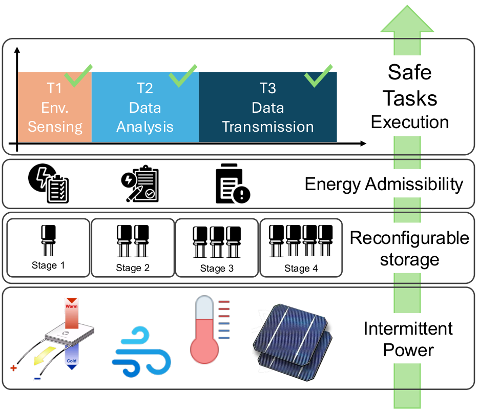
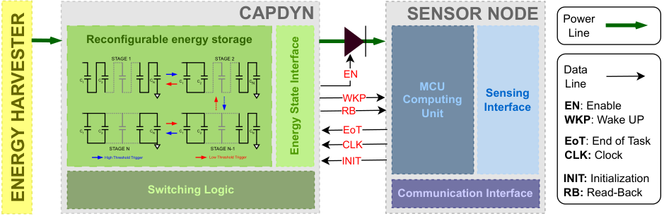
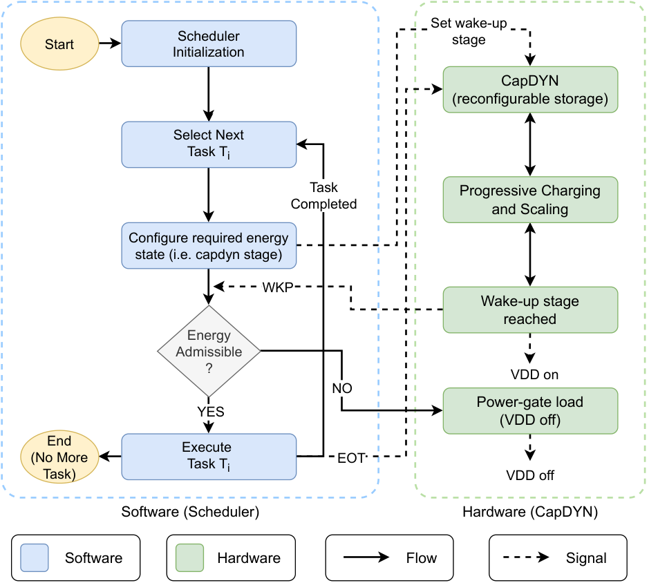
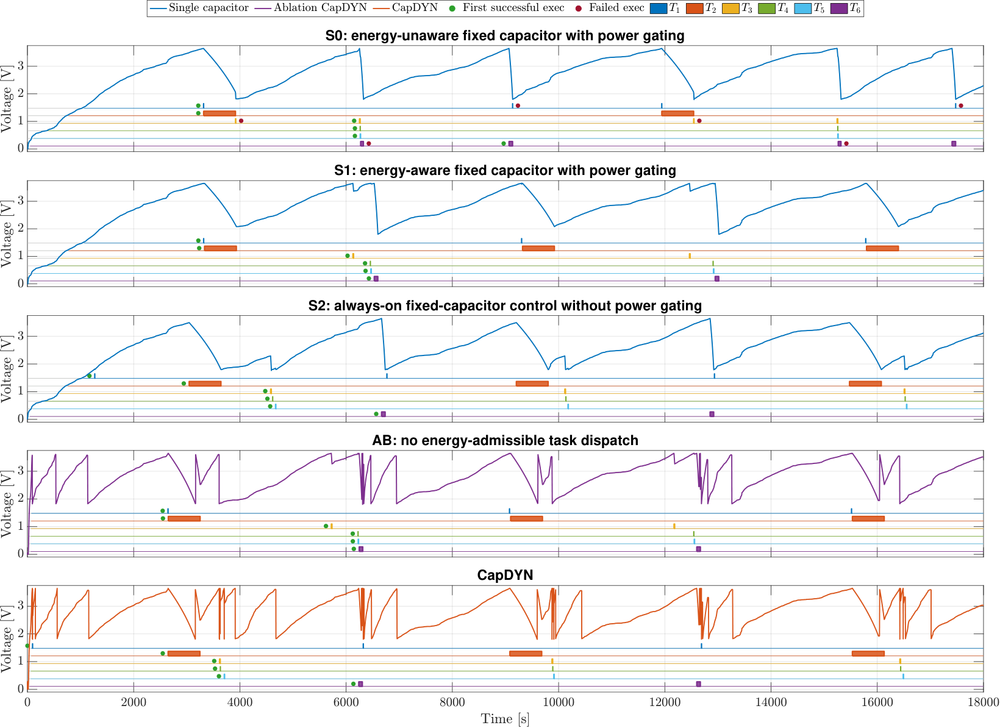

# Reliable Energy-Aware Task Execution for Battery-free Wireless Sensors

**Matteo Nardello · Maria Doglioni · Patrick Pastorelli · Davide Brunelli**

[](#publication) [](#publication) [](LICENSE_SCOPE.md)

<p align="center">
  
</p>

## Overview

Battery-free wireless sensors must operate with intermittently harvested energy. Starting a task before sufficient energy has accumulated can cause a power failure, wasting the energy already spent on partially completed work. Conversely, always waiting for a large fixed capacitor to charge can delay smaller, inexpensive sensing tasks.

This work combines **task-level energy-admission control** with **CapDYN**, a dynamically reconfigurable capacitor bank. The scheduler selects an atomic task and configures the required energy-storage stage; CapDYN enables execution when that stage is available and disconnects the load when the task finishes. This avoids continuous software-side energy polling and reduces failed execution attempts, **provided that profiled energy bounds and safety margins hold**.

<p align="center">
  
</p>

*System Architecture.*

## Key ideas

- **Energy admissibility:** execute task *T<sub>i</sub>* only when stored energy satisfies *E<sub>s</sub>(t) ≥ E<sub>i</sub> + E<sub>margin</sub>*.
- **Programmable energy state:** map each profiled task to a CapDYN wake-up stage instead of waiting for a universal full-storage threshold.
- **Event-driven operation:** configure the required stage, wait for hardware wake-up, execute the task, and power-gate on completion.
- **Hardware–software co-design:** operation requires suitable energy-state feedback and controlled load activation; it is not a hardware-agnostic general-purpose scheduler.

<p align="center">
  
</p>

*Software Architecture.*

## Results reported in the paper

The evaluation combines an MSP430-based sensing workload with LTspice characterization of the energy-storage architectures. It compares monolithic capacitors, energy-aware fixed-capacitor control, and an ablation with reconfigurable storage but no intermediate-stage admission.

| Reported result | Value / interpretation |
|---|---|
| Effective energy efficiency | Up to **97.17%** for the application-derived (exponential) workload |
| Effective energy efficiency | Up to **97.46%** for the synthetic linear workload |
| Successful task completions | Up to **41.67%** more than the energy-unaware fixed-capacitor baseline S0 |
| Reliability | Zero task failures under the **evaluated conditions** and valid profiling assumptions |
| Design sweep | CapDYN **D1/D2**, **3–7 stages**; heterogeneous task-energy distributions |

Performance depends on task-energy distribution, capacitor-stage granularity, infrastructure power, and baseline. For some timing metrics, a fixed-capacitor energy-aware baseline outperforms CapDYN on less favorable workload distributions; see the article for the complete comparison.



*Voltage and task execution comparison (best-performing four-stage D2 configuration, exponential workload).*

## Repository contents

```text
.
├── firmware/       # MSP430FR5994/CapDYN scheduler source (IEEE SENSORS 2025 snapshot)
├── figures/        # Rendered PNG paper figure
├── data/           # Published task profiles and capacitor-stage tables (CSV)
├── ltspice/        # LTspice models
├── docs/           # Firmware notes
├── CITATION.cff    # GitHub citation metadata
├── CITATION.bib    # BibTeX reference to the paper
├── LICENSE         # MIT license copied from upstream firmware
└── LICENSE_SCOPE.md
```

### Firmware

`firmware/` CapDyn Scheduler repository, including its MSP430FR5994 C sources, Hibernus support, drivers and original license. The main scheduler functions are `task_create()`, `scheduler_init()`, `next_task()` and `scheduler_start()`; task selection is round-robin by default and may be replaced via the weak `next_task()` function. See [firmware notes](docs/firmware.md).

### Task profiles and storage configurations

`data/task_profiles_from_paper_table_II.csv` contains the six profiled task categories for both energy distributions and the corresponding CapDYN stage assignments. `data/stage_capacity_energy_from_paper_table_III.csv` reproduces the published D1/D2 stage-capacitance/available-energy values. These are **published tabulated values**, not oscilloscope-level raw traces.

### LTspice simulations

The publication compares four reference configurations:

| ID | Energy management / reference configuration |
|:--:|---|
| **S0** | Energy-unaware monolithic capacitor with threshold-based activation/deactivation |
| **S1** | Energy-aware monolithic capacitor with upper-threshold wake-up |
| **S2** | Task-dependent threshold activation using an always-on MSP430 and programmable monitor |
| **AB** | Reconfigurable CapDYN capacitor bank without intermediate-stage energy-admissible dispatch |

## Reproducing the experiments

1. Use the [firmware notes](docs/firmware.md) to set up a compatible MSP430FR5994 development toolchain and verify your hardware wiring. A ready-to-build CCS workspace is not included.
2. Inspect published [task profiles and energy-stage tables](data/README.md) and the evaluation setup in Section V of the paper.
3. Obtain the original irradiance dataset cited by the paper from its upstream provider; the trace is not redistributed here.
4. **Once released**, use the LTspice schematics, stimulus files and scripts in `ltspice/` to regenerate circuit simulations; match the paper's 18,000 s evaluation window and energy-input conditions.
5. Compare the outputs against paper Tables IV–X, and document simulator/compiler versions and source revision.

For included/excluded artifacts and a checklist, read [docs/reproducibility.md](docs/reproducibility.md).

## Publication

> M. Nardello, M. Doglioni, P. Pastorelli, and D. Brunelli, **"Reliable Energy-Aware Task Execution for Battery-free Wireless Sensors,"** *IEEE Sensors Journal*, accepted for publication (9 October 2026). **DOI and final bibliographic details pending.**

Please cite the journal publication when using the methodology or results. GitHub also supports the [CITATION.cff](CITATION.cff) file, and the [BibTeX entry](CITATION.bib) will be updated once the journal assigns its DOI.

## License and acknowledgments

The **scheduler source is released under the MIT license**, retained unchanged from upstream including the original copyright notice. Third-party code also has its own licenses (including LGPL, Clear BSD, BSD-style terms, and MIT). The firmware license does **not** automatically apply to all publication figures, third-party data, or possible future LTspice files. See [LICENSE_SCOPE.md](LICENSE_SCOPE.md) and preserve third-party notices.
